# Hollow Knight and Silksong Companion

The companion to the [Hollow Knight and Silksong theme](https://github.com/abdullahhasan42/hollow-knight-and-silksong-theme). It turns empty tabs into a game title screen, fades in an area card whenever you open a note, adds a soul vessel HUD to the status bar, and rests at a bench when you save. It works without the theme, but it is drawn to match it.

<table>
<tr>
<td width="50%">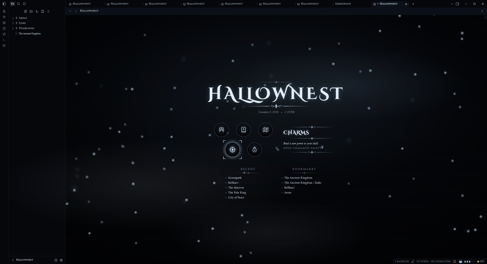 <b>Hallownest, Inventory panel</b></td>
<td width="50%">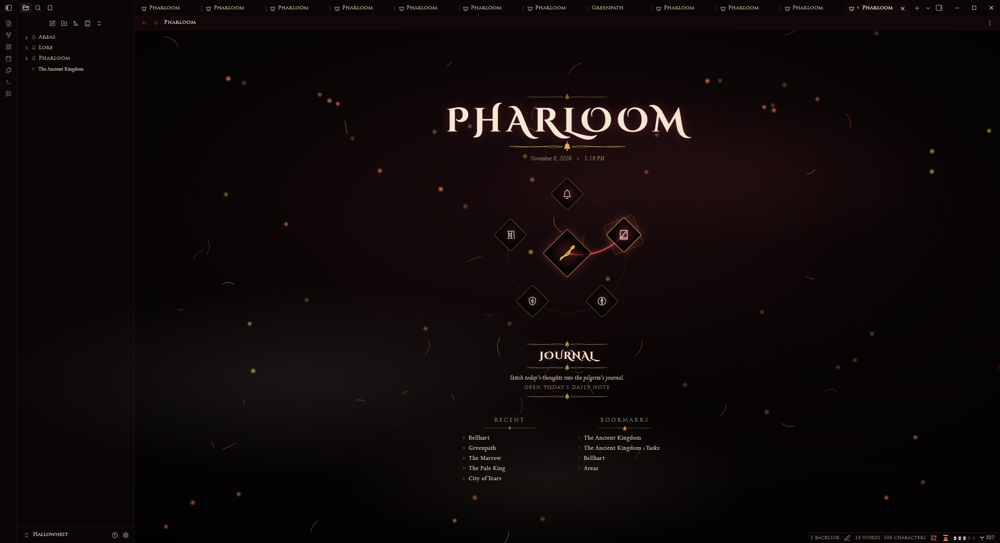 <b>Pharloom, Crest ring</b></td>
</tr>
</table>

> [!TIP]
> **Pair it with the theme.** The colours, fonts, ornaments, callout icons and both kingdoms' styling come from the [Hollow Knight and Silksong](https://github.com/abdullahhasan42/hollow-knight-and-silksong-theme) theme. The plugin works with any theme, but it is drawn to match this one.

## Contents

- [Title screen](#title-screen)
- [Configure the menu](#configure-the-menu)
- [Area title cards](#area-title-cards)
- [HUD](#hud)
- [Bench](#bench)
- [Install](#install)
- [Privacy](#privacy)
- [Commands](#commands)

## Title screen

Every empty tab shows the title screen: the title (your vault name by default), the date and time, a game menu, and your recent notes and bookmarks side by side. Soul motes drift in Hallownest; silk threads and embers fall in Pharloom.

<table>
<tr>
<td width="50%"> <b>Inventory panel</b> (Hallownest default)</td>
<td width="50%"> <b>Crest ring</b> (Pharloom default)</td>
</tr>
<tr>
<td>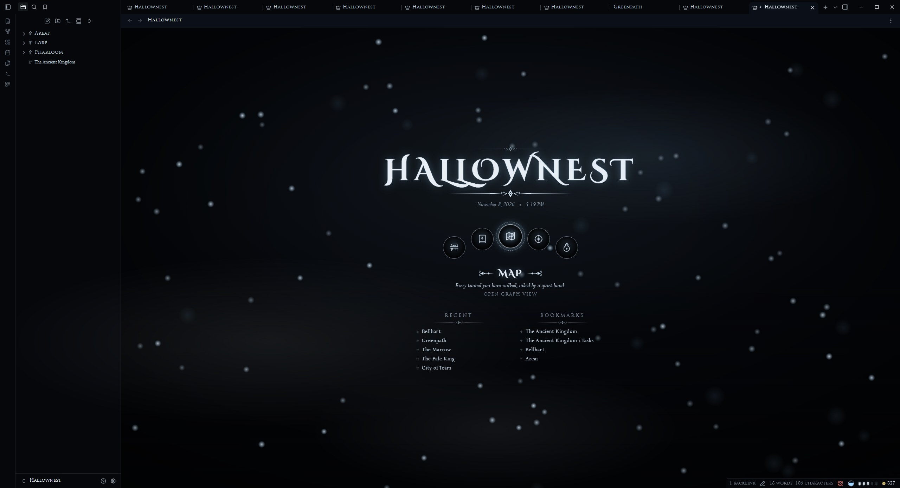 <b>Medallion arc</b> (Hallownest)</td>
<td>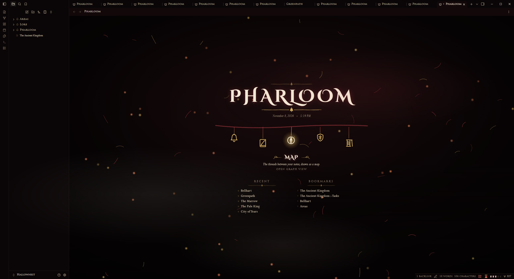 <b>Hanging bells</b> (Pharloom)</td>
</tr>
<tr>
<td>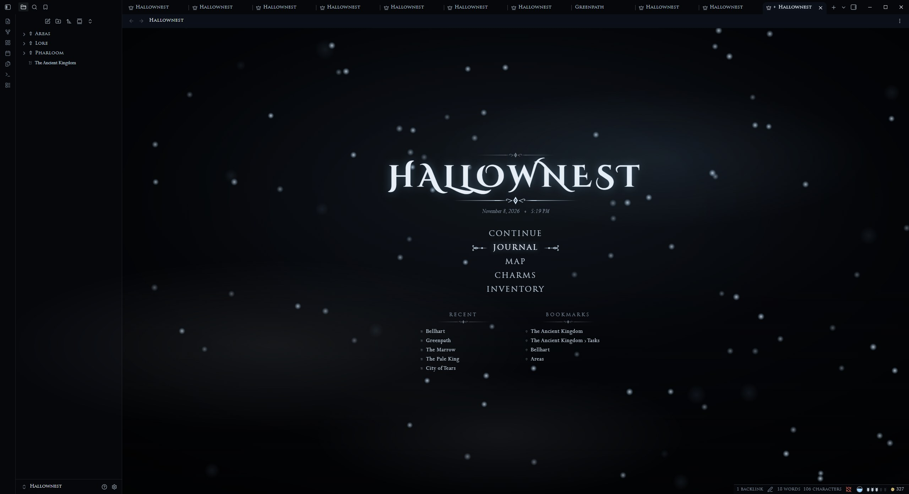 <b>Classic</b> (Hallownest)</td>
<td>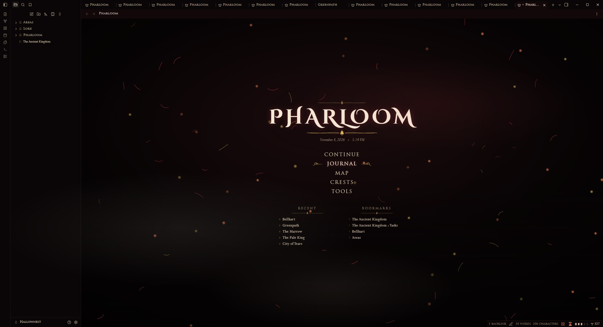 <b>Classic</b> (Pharloom)</td>
</tr>
</table>

Pick the style in **Style Settings, Hollow Knight and Silksong, Kingdom**. Move with the mouse or the arrow keys; press Enter or click to open.

## Configure the menu

In **Settings, Hollow Knight and Silksong Companion**:

- **Title**: starts as your vault name. Type anything else, or clear it to show the kingdom name. "Use vault name" puts the default back.
- **Wallpaper**: any image in your vault, behind the title screen.
- **Each menu entry**: show or hide it; its label; what it opens (last note, a note, a folder or any command, with autocomplete); its icon from the game icon set; its description line.

<table>
<tr>
<td width="50%">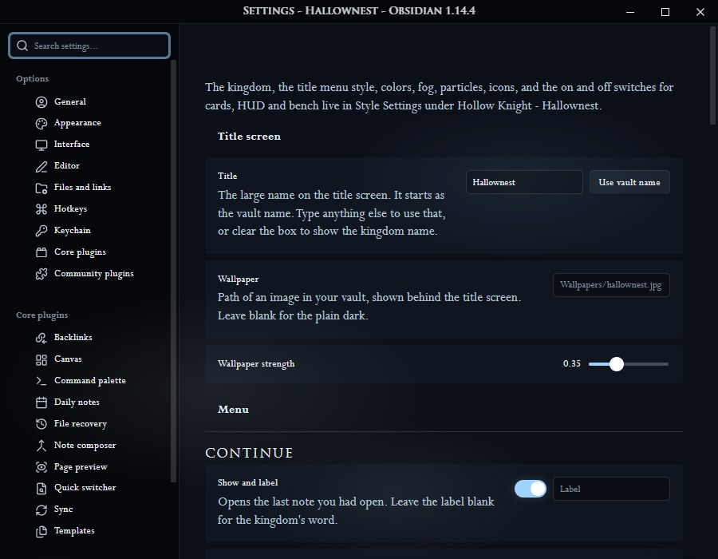 Title, wallpaper and the first menu entries.</td>
<td width="50%">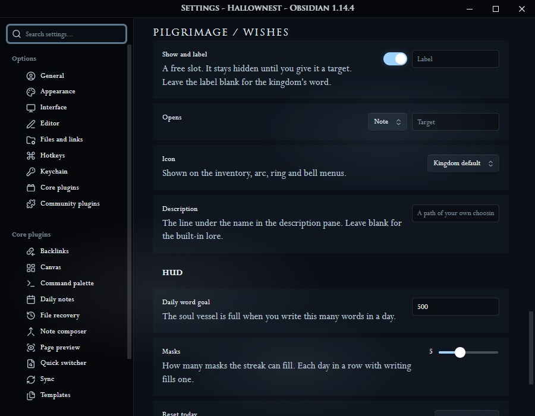 One entry: show, label, opens, icon, description.</td>
</tr>
</table>

| Entry | Opens by default |
| --- | --- |
| Continue | Your last note |
| Journal | Today's daily note |
| Map | The graph |
| Charms / Crests | The command palette |
| Inventory / Tools | The quick switcher |
| Pilgrimage / Wishes | A free slot, hidden until you give it a target |

## Area title cards

Opening a note in a pane dims the pane and fades in the note's name, with its folder above it. The card stays fully visible for exactly the hold time set in Style Settings (default 0.8 seconds). Switching between panes that already show their notes does not show a card.

<table>
<tr>
<td width="50%">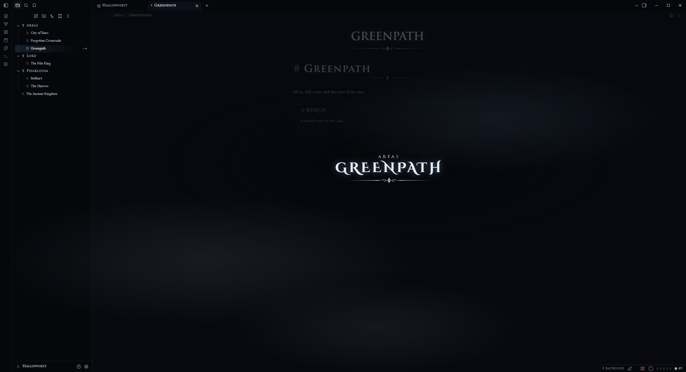 Hallownest</td>
<td width="50%">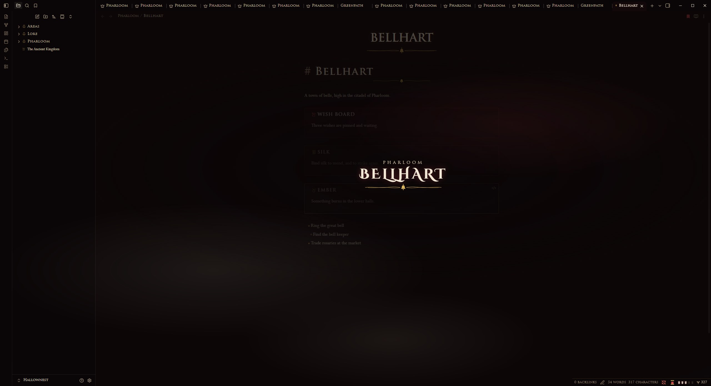 Pharloom</td>
</tr>
</table>

## HUD

| Part | Meaning |
| --- | --- |
| Soul vessel (silk spool in Pharloom) | Fills toward your daily word goal |
| Masks | One for each day in a row you wrote |
| Geo (Rosaries in Pharloom) | Words in your whole vault |

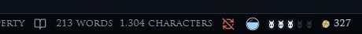
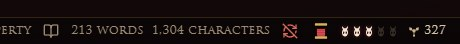

Click the HUD for a tally. Words count when you add them; deleting text does not drain the vessel.

<table>
<tr>
<td width="50%">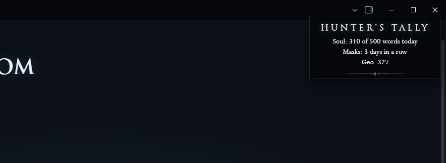 Hunter's tally</td>
<td width="50%">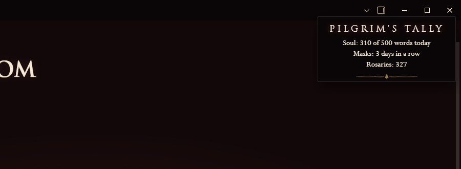 Pilgrim's tally</td>
</tr>
</table>

## Bench

Every save, with Ctrl+S or the command, sends a glow up the pane and shows "Rested".

<table>
<tr>
<td width="50%">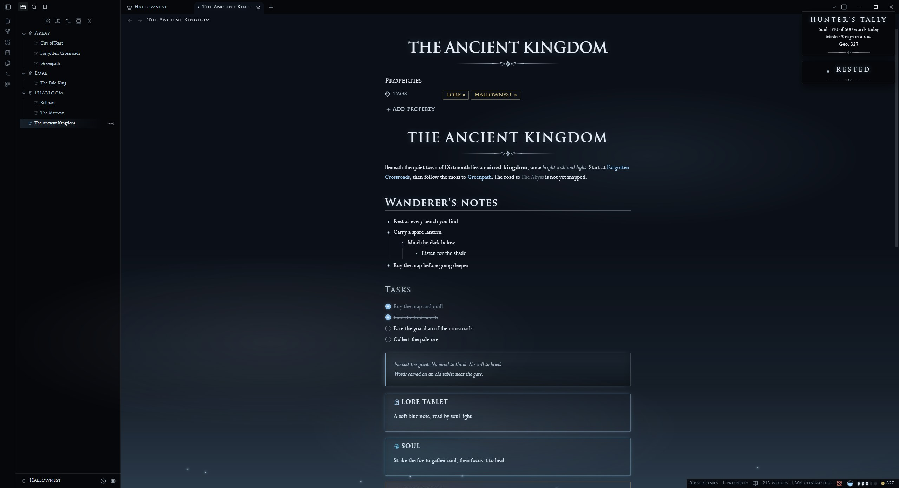 Hallownest</td>
<td width="50%">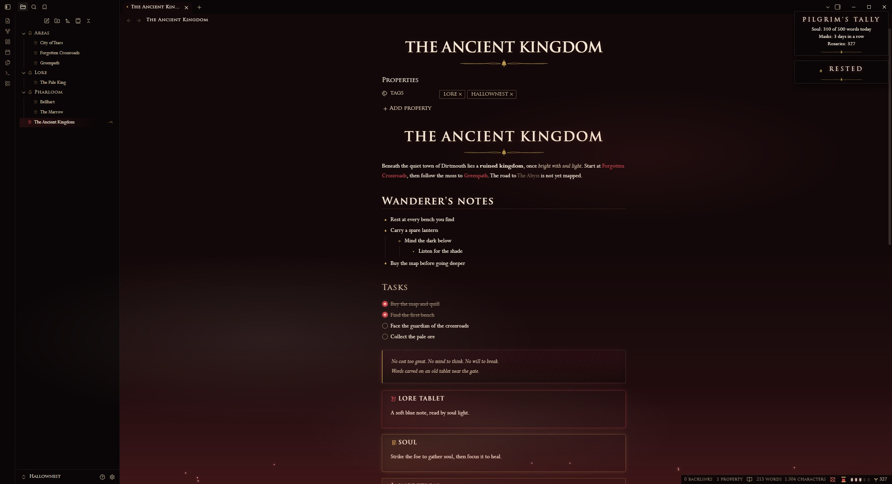 Pharloom</td>
</tr>
</table>

## Install

**From Obsidian** (recommended):
1. Open **Settings, Community plugins**, then select **Browse**.
2. Search for **Hollow Knight and Silksong Companion**, then select **Install** and **Enable**.

**With BRAT** (beta builds):
1. Install **BRAT** from Community plugins.
2. Run "BRAT: Add a beta plugin" with `abdullahhasan42/hollow-knight-and-silksong-plugin`.
3. Enable **Hollow Knight and Silksong Companion** under Community plugins.

**By hand:**
1. Download `main.js`, `manifest.json` and `styles.css` from the latest release.
2. Put them in `<your vault>/.obsidian/plugins/hollow-knight-hallownest/`.
3. Reload Obsidian and enable the plugin under Community plugins.

Install **Style Settings** too: the kingdom, the menu style and the visual switches live there.

<table>
<tr>
<td width="50%">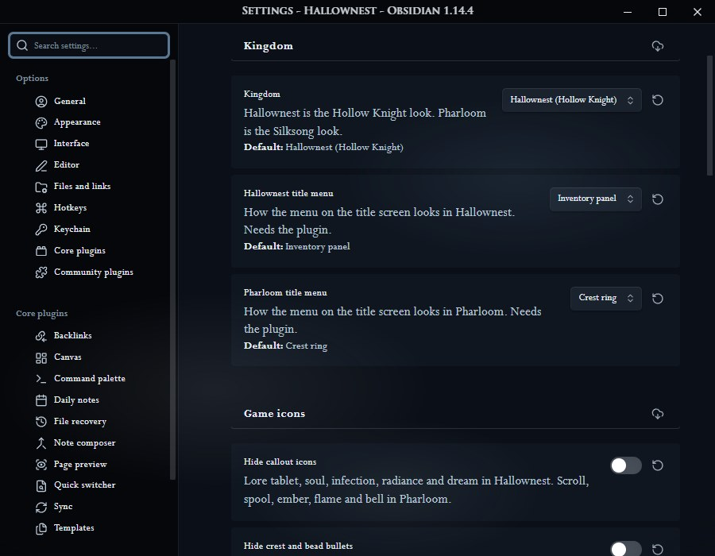 Kingdom and menu styles</td>
<td width="50%">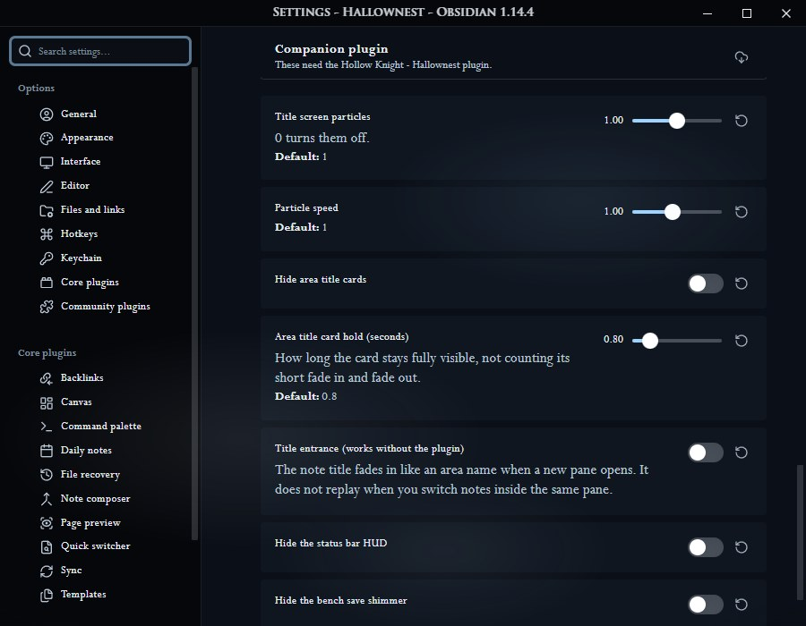 Particles, cards, HUD and bench switches</td>
</tr>
</table>

## Privacy

The plugin makes no network requests and collects no data. It only reads your vault to count words, list recent notes and open the targets you choose.

## Performance

Particles draw at 30 frames a second (15 under Low power) and stop while Obsidian is in the background or the title tab is hidden. Animations follow your system's reduced motion setting and the theme's Still air switch.

## Commands

- Return to the title screen
- Rest at bench (save)
- Show the area title card

## License

MIT, see [LICENSE](LICENSE). The icons and ornaments are original drawings.

> [!WARNING]
> This is an unofficial fan project, made because the author loves these games. It is not affiliated with or endorsed by Team Cherry.
